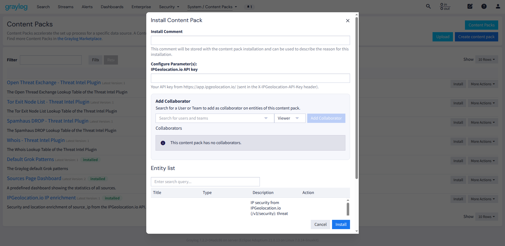
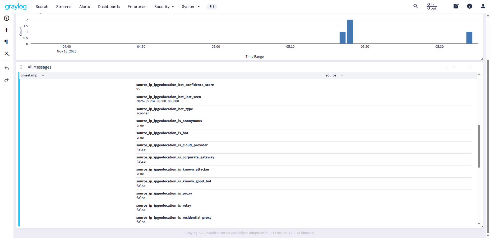
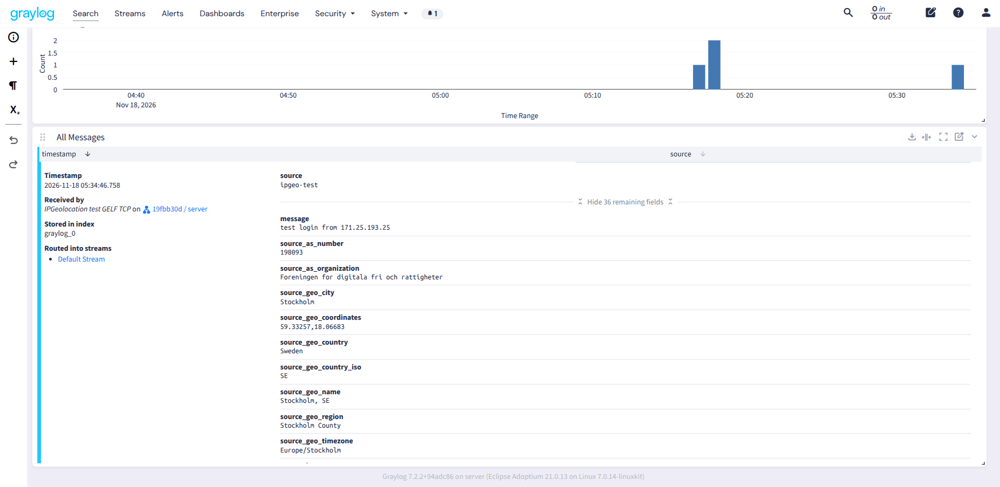

# IPGeolocation.io content pack for Graylog

Enriches the `source_ip` field of your Graylog messages with [IPGeolocation.io](https://ipgeolocation.io) data:

- **Security**: threat score, VPN, proxy, residential proxy (with last-seen dates and 7/30-day activity), Tor, relay, bot, spam, known attacker, cloud provider and corporate gateway signals.
- **Location**: country, region, city, coordinates, time zone and ASN, in Graylog's standard `source_geo_*` and `source_as_*` fields.

The two lookups are separate pipelines, so you can switch on either one or both, per stream.

Tested with Graylog 7.2.2.

## Requirements

- Graylog 7.2 (tested with 7.2.2; other versions are untested).
- An IPGeolocation.io API key from the [dashboard](https://app.ipgeolocation.io/). A free key covers the Location lookup; the Security lookup needs a paid plan.
- Outbound HTTPS from your Graylog nodes to `api.ipgeolocation.io`.

## Install

1. **Upload**: *System > Content Packs > Upload*, choose `content_pack.json`.
2. **Install**: click *Install* next to *IPGeolocation.io IP enrichment* and enter your API key.
3. **Set the error cache** (recommended): open *System > Lookup Tables > Data Adapters*, edit *IPGeolocation.io Security* and *IPGeolocation.io Location*, and set *Custom Error TTL* to 1 hour. Graylog content packs don't carry this setting; without it, a failed lookup (invalid key, a lookup your plan doesn't include, credit limit) is retried every 5 seconds for as long as messages with that IP keep coming.
4. **Switch it on**: open *System > Pipelines*, edit *IPGeolocation.io Security* and/or *IPGeolocation.io Location*, and connect them to the streams you want enriched. Nothing calls the API until a pipeline is connected.

## What it installs

| Item | Name |
| --- | --- |
| Data adapters (HTTP JSONPath) | `ipgeolocation-security` (`/v3/security`), `ipgeolocation-location` (`/v3/ipgeo`) |
| Caches | `ipgeolocation-security-cache`, `ipgeolocation-location-cache`: 24 hours per IP, up to 100,000 IPs per node |
| Lookup tables | `ipgeolocation-security`, `ipgeolocation-location` |
| Pipelines | *IPGeolocation.io Security*, *IPGeolocation.io Location* (not connected to any stream) |
| Pipeline rules | *IPGeolocation.io security: source_ip*, *IPGeolocation.io location: source_ip*, *IPGeolocation.io location name: source_ip* |
| URL allowlist entry | `^https://api\.ipgeolocation\.io/v3/.*$` |

## Fields

**Security** (pipeline *IPGeolocation.io Security*), all prefixed `source_ip_ipgeolocation_`:

`threat_score` (0-100), `is_tor`, `is_vpn`, `vpn_provider_names`, `vpn_confidence_score`, `vpn_last_seen`, `is_proxy`, `proxy_provider_names`, `proxy_confidence_score`, `proxy_last_seen`, `proxy_days_seen_7d`, `proxy_days_seen_30d`, `proxy_provider_count_30d`, `is_residential_proxy`, `is_relay`, `relay_provider_name`, `is_anonymous`, `is_known_attacker`, `is_bot`, `bot_type`, `bot_operator_name`, `bot_confidence_score`, `bot_last_seen`, `is_known_good_bot`, `is_spam`, `is_cloud_provider`, `cloud_provider_name`, `is_corporate_gateway`, `corporate_gateway_type`, `corporate_gateway_provider_name`. Empty values are not stored.

A low threat score means no risk signals were found, not that the address is safe.

**Location** (pipeline *IPGeolocation.io Location*), the same fields and formats Graylog's GeoIP processor writes:

| Field | Example |
| --- | --- |
| `source_geo_coordinates` | `59.33257,18.06683` |
| `source_geo_country_iso` | `SE` |
| `source_geo_country` | `Sweden` |
| `source_geo_region` | `Stockholm County` |
| `source_geo_city` | `Stockholm` |
| `source_geo_name` | `Stockholm, SE` |
| `source_geo_timezone` | `Europe/Stockholm` |
| `source_as_number` | `198093` |
| `source_as_organization` | `Foreningen for digitala fri och rattigheter` |

Dashboards and widgets built on these fields keep working when you switch to IPGeolocation.io. Don't run Graylog's GeoIP processor on `source_ip` at the same time, because both write the same fields.

## How it works

- The rules run only when `source_ip` is a valid public IPv4 or IPv6 address. Private and reserved ranges (Graylog's own reserved IPv4 list, plus `::/128`, `::1/128`, `100::/64`, `2001:db8::/32`, `fc00::/7`, `fe80::/10`, `ff00::/8`) are skipped without an API call.
- Each lookup calls the API once per unique IP per 24 hours on each Graylog node; repeats come from the cache. Credits are charged per lookup, so connect the pipelines only to the streams you need.
- The API key is sent in the `X-IPGeolocation-API-Key` header, never in a URL. Graylog stores it unencrypted in the data adapter configuration, so it is visible to anyone who can open that data adapter's settings.
- When a lookup fails, the rule adds no fields. Graylog logs a warning with the request URL, which does not contain the key.

## Enriching other fields

Copy the rules, replace `source_ip` with your field (for example `destination_ip`), and change the output prefix: `destination_ip_ipgeolocation_` for security, `destination_geo_` and `destination_as_` for location.

## License

[MIT](LICENSE)
